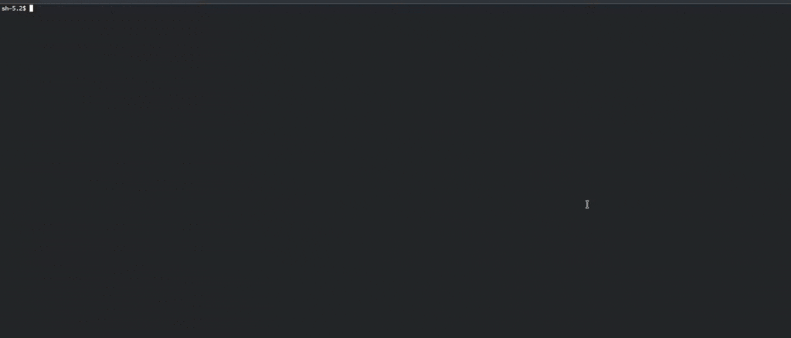

# sls 
Simple ls, a ls version wih useful paramenters.

# Description
sls is not a one to one copy of the ls command, instead is a command to list directories contents with useful functions to represent the data in different formats.

# Dependencies
Install Chicken Scheme in your platform.

# Installing
Use the chicken-install command to install the eggs required by the tool (chicken-install is the version on Arch linux, check your platform especific commands.).

```bash
sudo chicken-install args srfi-1 list-utils fmt fmt-color json srfi-13
```

```bash
git clone https://github.com/josebaezmedina/sls.git
cd sls
chicken-csc sls.scm
```

This will generate a sls executable file that you can copy to your /usr/bin folder or make a static link to it.


# Usage

- sls = list contents
- sls -a = show hidden files
- sls -l = show cotents in vertical mode
- sls -t = show contents as a table
- sls -j = show contents in json format
- sls -x = show contents in xml format
- sls -w = show contents as a html page


# Author
Jose Baez
[@josebaezmedina](https:github.com/josebaezmedina)
